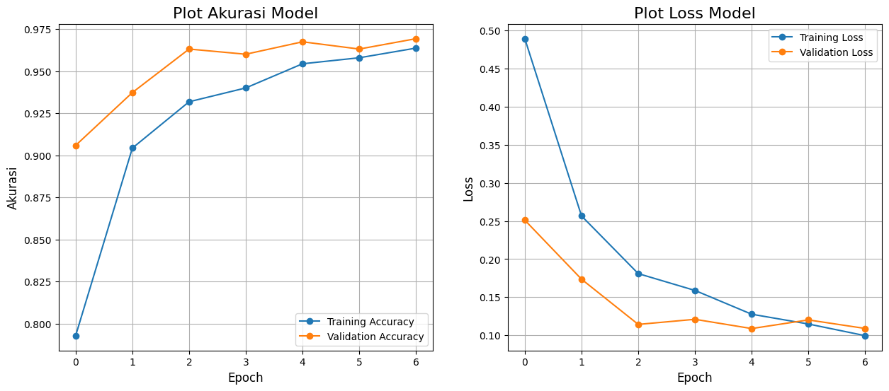
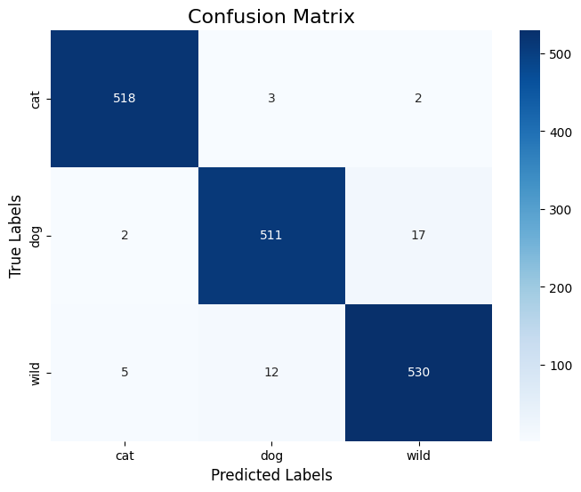
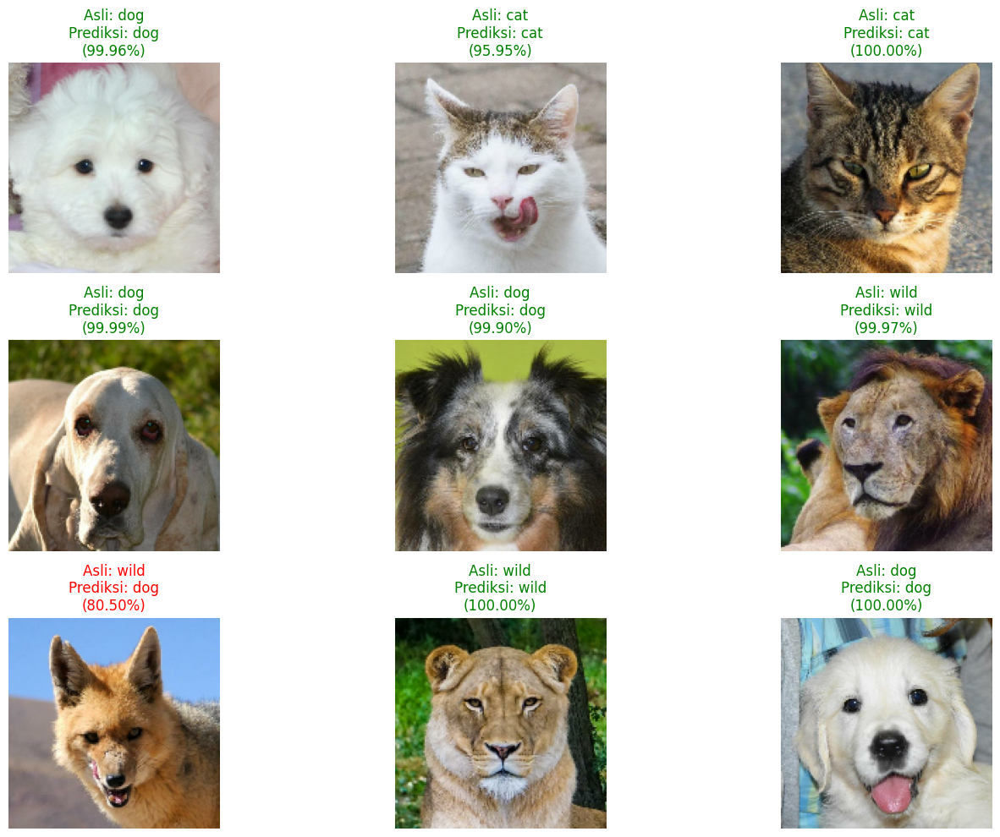

# Proyek Klasifikasi Gambar: Klasifikasi Wajah Hewan

Proyek ini adalah submission untuk kelas "Machine Learning Terapan" dari Dicoding. Tujuan dari proyek ini adalah membangun model deep learning menggunakan Convolutional Neural Network (CNN) untuk mengklasifikasikan gambar wajah hewan ke dalam tiga kategori: kucing (`cat`), anjing (`dog`), dan hewan liar (`wild`).

**Author:** Desnia Anindy Irni Hareva  
**Email:** desnia.anindy28@student.uns.ac.id  
**ID Dicoding:** desniaanindy

---

##  Ringkasan Proyek

Model ini dilatih menggunakan dataset "Animal Faces" dari Kaggle, yang berisi lebih dari 16.000 gambar. Sesuai dengan masukan dari reviewer, dataset digabungkan terlebih dahulu lalu dibagi secara manual menjadi data latih (80%), data validasi (10%), dan data tes (10%) untuk memastikan evaluasi yang adil. Model ini berhasil mencapai akurasi **97.44%** pada data tes, melampaui target bonus >95%.

## Dataset

- **Sumber:** [Animal Faces (AFHQ)](https://www.kaggle.com/datasets/andrewmvd/animal-faces) di Kaggle
- **Total Gambar:** 16,130 gambar
- **Jumlah Kelas:** 3 kelas (`cat`, `dog`, `wild`)
- **Resolusi Gambar Asli:** Beragam (tidak seragam), memenuhi kriteria bonus.

---

## Arsitektur Model

Model ini dibangun menggunakan **Keras Sequential API** dengan arsitektur CNN sebagai berikut:

1.  **Input Layer**: Menerima gambar dengan ukuran `(150, 150, 3)`.
2.  **Data Augmentation**: Lapisan untuk augmentasi data secara *real-time* (`RandomFlip`, `RandomRotation`, `RandomZoom`) untuk mencegah *overfitting*.
3.  **Rescaling Layer**: Menormalisasi nilai piksel gambar dari rentang [0, 255] menjadi [0, 1].
4.  **Convolutional & Pooling Layers**: Terdiri dari 4 blok `Conv2D` dan `MaxPooling2D` untuk ekstraksi fitur hierarkis. Jumlah filter meningkat (32 -> 64 -> 128 -> 256) untuk menangkap pola yang semakin kompleks.
5.  **Dropout Layer**: Lapisan `Dropout` ditambahkan untuk regularisasi.
6.  **Classifier Head**: Lapisan `Flatten` diikuti oleh dua `Dense` layer. Lapisan output akhir menggunakan aktivasi `softmax` untuk klasifikasi multi-kelas.

## Hasil dan Evaluasi

Model ini menunjukkan performa yang sangat baik dan memenuhi semua kriteria yang dibutuhkan.

- **Akurasi Pelatihan Tertinggi**: 96.04%
- **Akurasi Validasi Tertinggi**: 96.92%
- **Akurasi pada Test Set**: **97.44%**
- **Loss pada Test Set**: 0.0903

### Grafik Pelatihan
Grafik di bawah ini menunjukkan bahwa model belajar dengan stabil tanpa adanya *overfitting* yang signifikan.

### Laporan Klasifikasi & Confusion Matrix
Laporan di bawah menunjukkan bahwa model memiliki nilai *precision* dan *recall* yang sangat seimbang untuk semua kelas. *Confusion matrix* mengonfirmasi bahwa model jarang melakukan kesalahan prediksi antar kelas.

---

## Uji Coba Model (Inference)

Untuk menunjukkan kemampuan praktis model, dilakukan uji coba prediksi pada 9 gambar acak dari *test set*. Hasilnya menunjukkan model dapat memprediksi dengan benar dan dengan tingkat kepercayaan yang tinggi.

---

## Struktur Direktori Submission

Proyek ini diorganisir dengan struktur direktori berikut:

submission/
├── notebook.ipynb                # File notebook utama proyek
├── README.md                     # File ini
├── requirements.txt              # Daftar library yang digunakan
├── image/                        # Folder berisi gambar untuk README
│   ├── Plot_Akurasi.png
│   ├── Confusion_Matrix.png
│   └── Inference.png
├── saved_model/                  # Model dalam format TensorFlow SavedModel
├── tfjs_model/                   # Model dalam format TensorFlow.js
└── tflite/                       # Model dalam format TensorFlow Lite
├── model.tflite
└── label.txt

---

## Alur Kerja dan Cara Menjalankan Notebook

Untuk menjalankan ulang proyek ini, ikuti langkah-langkah berikut:

1.  **Buka di Google Colab**: Buka file `notebook.ipynb` di lingkungan Google Colab.
2.  **Autentikasi Kaggle**: Jalankan sel pertama (`Persiapan Lingkungan`). Anda akan diminta untuk mengunggah file `kaggle.json`.
    -   **Penting**: File `kaggle.json` adalah token API pribadi Anda dari Kaggle yang diperlukan untuk mengunduh dataset. Anda bisa mendapatkannya dari situs web Kaggle di bagian **Account > Settings > Create New Token** atau menggunakan file yang ada di folder.
3.  **Jalankan Semua Sel**: Setelah autentikasi berhasil, Anda dapat menjalankan seluruh notebook dengan memilih **Runtime > Run all**. Kode akan berjalan secara berurutan, mulai dari mengunduh data, melatih model, hingga evaluasi.
4.  **Unduh Hasil Akhir**: Di akhir eksekusi, sel terakhir akan secara otomatis mengemas semua hasil (semua format model dan `requirements.txt`) ke dalam satu file bernama `submission.zip` dan memulai proses unduh ke komputer Anda.

---